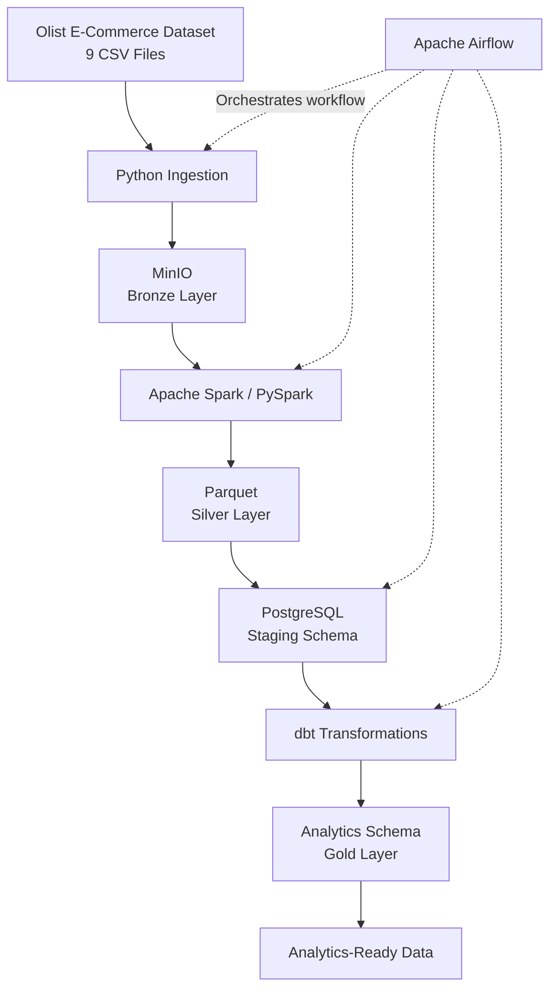

# E-Commerce ELT Data Platform

**An end-to-end data engineering project that transforms raw e-commerce data into analytics-ready dimensional models using Python, Apache Spark, MinIO, PostgreSQL, Apache Airflow and dbt.**

<p align="center">
  <strong>Python · PySpark · Apache Airflow · MinIO · PostgreSQL · dbt · Docker</strong>
</p>

---

## Project Overview

This project implements an end-to-end ELT (Extract, Load, Transform) data platform using the Brazilian E-Commerce Public Dataset by Olist.

The objective is to build a practical data engineering workflow that demonstrates how raw data can be ingested, stored, processed, validated, orchestrated and transformed into structured datasets for analytical use.

The platform follows a Medallion Architecture with Bronze, Silver and Gold layers.

### Key Highlights

| Metric | Result |
|---|---:|
| Source datasets | 9 CSV files |
| Source records | ~1.55 million |
| Duplicate geolocation records removed | 261,831 |
| Valid records loaded into staging | ~1.29 million |
| dbt tests passed | 25 |
| dbt warnings | 0 |
| dbt errors | 0 |
| Airflow pipeline tasks | 6 |

*These figures represent the successfully executed project run documented during development.*

---

## Architecture

The platform follows this end-to-end data flow:



### Medallion Architecture

| Layer | Technology | Responsibility |
|---|---|---|
| Bronze | MinIO | Store original source files as immutable raw objects |
| Silver | PySpark + Parquet | Clean, validate, deduplicate and standardize datasets |
| Gold | PostgreSQL + dbt | Build fact and dimension models for analytical workloads |

---

## Technology Stack

| Technology | Purpose |
|---|---|
| Python | Data ingestion, validation and automation |
| Apache Spark | Distributed data processing |
| PySpark | Data transformation and processing logic |
| MinIO / Silo | S3-compatible object storage |
| Parquet | Columnar storage format for processed datasets |
| PostgreSQL | Relational data warehouse |
| dbt Core | SQL transformations, dimensional modelling and testing |
| Apache Airflow | Workflow orchestration and task dependencies |
| Docker | Containerized services and execution environments |
| SQL | Data validation, querying and transformations |

---

## Pipeline Implementation

### 1. Data Ingestion — Bronze Layer

**Technology:** Python, MinIO

- Ingests nine source CSV datasets.
- Uploads raw files into MinIO object storage.
- Uses checksum-based validation to verify uploaded objects.
- Maintains ingestion manifests and batch identifiers.
- Supports repeatable ingestion without unnecessarily uploading unchanged files.

**Output:** Original raw datasets stored in the Bronze layer.

### 2. Data Processing — Silver Layer

**Technology:** Apache Spark, PySpark, Parquet

- Reads Bronze data from MinIO.
- Processes datasets using PySpark.
- Handles duplicate geolocation records.
- Performs data-quality and validation checks.
- Standardizes datasets for downstream processing.
- Writes curated datasets in Parquet format.

**Output:** Cleaned and standardized Silver datasets.

### 3. Data Warehouse Loading

**Technology:** Python, PostgreSQL

- Loads Silver-layer datasets into PostgreSQL.
- Maintains separate staging tables for individual source datasets.
- Includes batch identifiers to support batch-level traceability.
- Organizes staging data under the `staging` schema.

**Output:** Structured staging tables ready for transformation.

### 4. Data Modelling — Gold Layer

**Technology:** dbt Core, SQL, PostgreSQL

dbt transforms staging datasets into analytical models.

**Staging models:**

- `stg_customers`
- `stg_geolocation`
- `stg_order_items`
- `stg_orders`
- `stg_payments`
- `stg_reviews`
- `stg_products`
- `stg_sellers`
- `stg_category_translation`

**Fact models:**

- `fact_order_items`
- `fact_payments`
- `fact_reviews`

**Dimension models:**

- `dim_customers`
- `dim_products`
- `dim_sellers`
- `dim_date`

The resulting models are stored in the PostgreSQL `analytics` schema.

### 5. Workflow Orchestration

**Technology:** Apache Airflow, DockerOperator

The complete pipeline is orchestrated using the `ecommerce_elt_pipeline` DAG.

| Order | Task ID | Responsibility |
|---:|---|---|
| 1 | `ingest_bronze` | Upload raw datasets into MinIO |
| 2 | `extract_batch_id` | Extract and validate the ingestion batch ID |
| 3 | `process_silver` | Process Bronze data using PySpark |
| 4 | `load_postgres` | Load Silver datasets into PostgreSQL |
| 5 | `dbt_run` | Execute dbt transformations |
| 6 | `dbt_test` | Execute dbt data-quality tests |

DockerOperator executes the ingestion, Spark and dbt workloads in their respective containers.

The batch identifier is passed between pipeline stages to maintain batch-level consistency.

---

## Data Quality and Engineering Decisions

Data quality was treated as an important part of the pipeline rather than an optional final step.

### Source Data Findings

During initial profiling and investigation:

- Geolocation contained 261,831 exact duplicate rows.
- Review datasets contained missing comment fields.
- Order datasets contained missing delivery timestamps.
- Product datasets contained missing category and dimension attributes.
- Financial reconciliation identified 303 orders with mismatches between item-plus-freight amounts and payment totals.

### Engineering Decisions

- Remove exact duplicate geolocation records during Silver processing.
- Preserve original financial amounts instead of silently correcting discrepancies.
- Validate primary-key uniqueness and data relationships.
- Retain and investigate timestamp anomalies instead of silently modifying source values.
- Aggregate order items and payments independently before order-level financial reconciliation to avoid join fanout.
- Use appropriate decimal data types for financial calculations.
- Track batch identifiers across ingestion and warehouse loading.

### dbt Testing

The project includes dbt tests for model validation and custom SQL assertions covering:

- Fact table row-count consistency.
- Order-item uniqueness.
- Payment uniqueness.
- Review uniqueness.
- Model-level data-quality constraints.

**Recorded execution result:**

```text
PASS = 25
WARN = 0
ERROR = 0
SKIP = 0
TOTAL = 25
```

---

## Repository Structure

```text
ecommerce-elt-platform/
│
├── dags/
│   └── ecommerce_elt_pipeline.py
│
├── dbt/
│   ├── models/
│   │   ├── staging/
│   │   └── marts/
│   ├── tests/
│   ├── dbt_project.yml
│   └── profiles.yml
│
├── docker/
│   ├── airflow/
│   ├── dbt/
│   ├── ingestion/
│   └── spark/
│
├── docs/
│   └── source_data_assessment.md
│
├── ingestion/
│   ├── upload_to_bronze.py
│   ├── load_silver_to_postgres.py
│   ├── minio_client.py
│   ├── profile_dataset.py
│   └── data_quality_investigations/
│
├── spark/
│   └── jobs/
│       └── process_bronze_to_silver.py
│
├── sql/
│   └── ddl/
│       └── 01_create_staging_tables.sql
│
├── dashboards/
├── tests/
│
├── docker-compose.yml
├── requirements.txt
├── .env.example
├── .gitignore
└── README.md
```

---

## Getting Started

### Prerequisites

Make sure the following tools are available:

- Git
- Docker Engine
- Docker Compose
- Python 3
- Apache Airflow (separate orchestration environment)

The project was developed using Windows 11, WSL2 and Docker.

### 1. Clone the Repository

```bash
git clone https://github.com/velmurugan27s/ecommerce-elt-platform.git

cd ecommerce-elt-platform
```

### 2. Configure Environment Variables

Create a local environment file:

```bash
cp .env.example .env
```

Update `.env` with your own credentials.

The configuration includes:

- PostgreSQL username, password and database.
- PostgreSQL host port.
- MinIO root username and password.
- MinIO API and console ports.
- MinIO bucket and endpoint.

Never commit your actual `.env` file or expose credentials publicly.

### 3. Prepare the Dataset

Download the Brazilian E-Commerce Public Dataset by Olist.

Place the nine CSV files in:

```text
data/raw/
```

The raw dataset is excluded from Git to avoid committing large data files.

### 4. Start Infrastructure

Start PostgreSQL and MinIO:

```bash
docker compose up -d postgres minio
```

Check service health:

```bash
docker compose ps
```

### 5. Build the Processing Images

Build the Docker images using the provided Dockerfiles and the image tags configured in the Airflow DAG:

```bash
docker build -f docker/ingestion/Dockerfile \
  -t ecommerce-elt-platform-ingestion:latest .

docker build -f docker/spark/Dockerfile \
  -t ecommerce-elt-platform-spark:latest .

docker build -f docker/dbt/Dockerfile \
  -t ecommerce-elt-platform-dbt:latest .
```

### 6. Configure Airflow

The Airflow orchestration environment is configured separately from the main ELT Docker Compose stack.

Before running the DAG in another environment, review the project-specific settings in:

```text
dags/ecommerce_elt_pipeline.py
```

In particular, configure:

- `PROJECT_ROOT`
- `DOCKER_NETWORK`
- Docker image names
- Required environment variables
- Docker socket access and project volume mounts

The Airflow execution environment must be able to access the ELT Docker network, project files and Docker daemon.

### 7. Execute the Pipeline

Once the infrastructure, images and Airflow environment are configured:

1. Open the Airflow web interface.
2. Locate `ecommerce_elt_pipeline`.
3. Trigger a manual DAG run.
4. Monitor task execution in the Graph or Grid view.
5. Verify successful completion of all six tasks.

---

## Future Enhancements

Potential next steps for extending the platform include:

- Integrate a BI tool such as Metabase for interactive dashboards.
- Add automated pipeline monitoring and alerting.
- Implement incremental processing and more advanced recovery strategies.
- Introduce streaming ingestion with Apache Kafka.
- Add CI/CD workflows for automated testing and deployment.
- Expand data observability and pipeline-level quality monitoring.

---

## Dataset Attribution

This project uses the Brazilian E-Commerce Public Dataset by Olist.

The dataset contains anonymized e-commerce order, customer, product, seller, payment, review and geolocation information.

The dataset is used for educational and portfolio development purposes.

---

## Author

**Velmurugan S.**

Aspiring Data Engineer | Python | SQL | Apache Spark | Apache Airflow | dbt

- GitHub: [velmurugan27s](https://github.com/velmurugan27s)
- Project Repository: [E-Commerce ELT Data Platform](https://github.com/velmurugan27s/ecommerce-elt-platform)
- LinkedIn: [Connect with me](https://www.linkedin.com/in/velmurugan-s-5702b8429/)

---

*Built as a hands-on data engineering project to explore modern ELT architecture, distributed data processing, orchestration and analytical data modelling.*